# Pattern Selection Decision Tree

Start from the symptom — not the solution. This document maps production pain points to the patterns most likely to address them.

Six branches cover the concerns that drive most adoption decisions. The [Mermaid diagram](#decision-tree) is the primary view; the [text fallback table](#text-fallback) covers the same paths for readers who can't render it. If you already know your system type, the [system type quick pick](#system-type-quick-pick) cuts straight to the Critical and Required set.

---

## How to navigate

Pick the branch that matches the problem you're experiencing right now:

| Branch | The concern |
|--------|------------|
| [Reliability](#reliability) | Provider failures, retries making things worse, outages |
| [Cost](#cost) | Spend growing faster than traffic, single requests consuming disproportionate budget |
| [Visibility](#visibility) | Debugging is guesswork, quality degraded and you found out late |
| [Testing](#testing) | Can't verify whether a prompt change improved or regressed |
| [Safety](#safety) | PII in prompts, injection surfaces, agents taking uncontrolled actions |
| [Performance](#performance) | Latency unpredictable, throughput constrained |

---

## Decision Tree

The diagram below shows the top-level branches. Each leaf links to the detailed symptom table and branch walkthroughs below.

```mermaid
flowchart TD
    START(["What's your biggest pain point?"])

    START --> RELIABILITY["🛡️ Reliability\n─────────────────\nProvider failures,\noutages, retry storms"]
    START --> COST["💰 Cost\n─────────────────\nSpend too high or\ngrowing unexpectedly"]
    START --> VISIBILITY["🔭 Visibility\n─────────────────\nDebugging is\nguesswork"]
    START --> TESTING["🧪 Testing\n─────────────────\nCan't verify quality\nor detect regressions"]
    START --> SAFETY["🔒 Safety\n─────────────────\nPII, injection,\nagent control"]
    START --> PERF["⚡ Performance\n─────────────────\nLatency or throughput\nproblems"]

    RELIABILITY --> R1["Transient errors\n(429s, 503s)"]
    RELIABILITY --> R2["Retries amplifying\na degraded period"]
    RELIABILITY --> R3["Provider outage\ntakes system offline"]
    RELIABILITY --> R4["Single provider,\nno fallback"]

    R1 --> PA["Retry with Budget"]
    R2 --> PB["Circuit Breaker"]
    R3 --> PC["Graceful Degradation"]
    R4 --> PD["Multi-Provider Failover"]

    COST --> C1["Single request\nconsumes too much budget"]
    COST --> C2["Similar queries\nhitting LLM repeatedly"]
    COST --> C3["Same model\nfor every request"]
    COST --> C4["No visibility\ninto spend"]

    C1 --> PE["Token Budget Middleware"]
    C2 --> PF["Semantic Caching"]
    C3 --> PG["Model Routing"]
    C4 --> PH["Cost Dashboard"]

    VISIBILITY --> V1["Debugging failures\nis guesswork"]
    VISIBILITY --> V2["Don't know what\nprompt ran in prod"]
    VISIBILITY --> V3["Quality degraded,\ndetected it late"]
    VISIBILITY --> V4["Can't audit what\nchanged between prompts"]

    V1 --> PI["Structured Tracing"]
    V2 --> PJ["Prompt Version Registry"]
    V3 --> PK["Output Quality Monitoring\nor Drift Detection"]
    V4 --> PL["Prompt Diffing"]

    TESTING --> T1["No systematic\nquality measurement"]
    TESTING --> T2["Deployed changes\nwithout knowing if regressed"]
    TESTING --> T3["Would deploy to\n100% of traffic immediately"]
    TESTING --> T4["Only testing\nhappy paths"]
    TESTING --> T5["Assertions break on\nrephrasing, not regressions"]

    T1 --> PM["Eval Harness"]
    T2 --> PN["Regression Testing"]
    T3 --> PO["Prompt Rollout Testing"]
    T4 --> PP["Adversarial Inputs"]
    T5 --> PQ["Snapshot Testing"]

    SAFETY --> S1["User input touches\nthe LLM pipeline"]
    SAFETY --> S2["LLM returns wrong\nschema or broken JSON"]
    SAFETY --> S3["User-controlled content\nin prompts"]
    SAFETY --> S4["Agent takes\nhigh-stakes actions"]

    S1 --> PR["PII Detection"]
    S2 --> PS["Structured Output Validation"]
    S3 --> PT["Prompt Injection Defense"]
    S4 --> PU["Human-in-the-Loop"]

    PERF --> P1["Latency varies\n3–10× with no explanation"]
    PERF --> P2["Stream drops or\nconsumers can't keep up"]
    PERF --> P3["Rate limits hit under\nmoderate concurrency"]
    PERF --> P4["Processing items\none-by-one at volume"]

    P1 --> PV["Latency Budget"]
    P2 --> PW["Streaming Backpressure"]
    P3 --> PX["Concurrent Request Management"]
    P4 --> PY["Request Batching"]

    classDef pattern fill:#dbeafe,stroke:#3b82f6,color:#1e3a5f,rx:6
    classDef branch fill:#f0fdf4,stroke:#16a34a,color:#14532d,rx:6
    classDef question fill:#fefce8,stroke:#ca8a04,color:#78350f,rx:4
    classDef start fill:#fdf4ff,stroke:#9333ea,color:#581c87,rx:8

    class PA,PB,PC,PD,PE,PF,PG,PH,PI,PJ,PK,PL,PM,PN,PO,PP,PQ,PR,PS,PT,PU,PV,PW,PX,PY pattern
    class RELIABILITY,COST,VISIBILITY,TESTING,SAFETY,PERF branch
    class R1,R2,R3,R4,C1,C2,C3,C4,V1,V2,V3,V4,T1,T2,T3,T4,T5,S1,S2,S3,S4,P1,P2,P3,P4 question
    class START start
```

---

## Text Fallback

The same decision paths as a lookup table — symptom on the left, pattern on the right. Every row is a documented production failure mode.

| Symptom | Pattern |
|---------|---------|
| Getting 429s, 503s, or transient API errors | [Retry with Budget](../patterns/resilience/retry-with-budget/) |
| Retries turning a brief degraded period into a full outage | [Circuit Breaker](../patterns/resilience/circuit-breaker/) |
| Provider outage takes the whole system offline | [Graceful Degradation](../patterns/resilience/graceful-degradation/) |
| Single provider with no fallback path | [Multi-Provider Failover](../patterns/resilience/multi-provider-failover/) |
| Single request consuming a disproportionate share of budget | [Token Budget Middleware](../patterns/cost-control/token-budget-middleware/) |
| Similar queries hitting the LLM with similar intent repeatedly | [Semantic Caching](../patterns/cost-control/semantic-caching/) |
| Using the same model for every request regardless of complexity | [Model Routing](../patterns/cost-control/model-routing/) |
| No visibility into daily or weekly LLM spend trends | [Cost Dashboard](../patterns/cost-control/cost-dashboard/) |
| Debugging production failures is reconstructing from guesswork | [Structured Tracing](../patterns/observability/structured-tracing/) |
| Can't tell which prompt was running in production during a failure | [Prompt Version Registry](../patterns/observability/prompt-version-registry/) |
| Output quality degraded — detected it via user reports, not monitoring | [Output Quality Monitoring](../patterns/observability/output-quality-monitoring/) |
| Output distribution shifted over time from corpus or model updates | [Drift Detection](../patterns/observability/drift-detection/) |
| Can't audit what changed between two prompt versions | [Prompt Diffing](../patterns/observability/prompt-diffing/) |
| No systematic way to score output quality across a test set | [Eval Harness](../patterns/testing/eval-harness/) |
| Deployed a prompt change without knowing whether it regressed | [Regression Testing](../patterns/testing/regression-testing/) |
| Prompt changes go to 100% of traffic immediately | [Prompt Rollout Testing](../patterns/testing/prompt-rollout-testing/) |
| Testing covers happy paths but not adversarial or edge-case inputs | [Adversarial Inputs](../patterns/testing/adversarial-inputs/) |
| Test assertions break on minor rephrasing rather than actual regressions | [Snapshot Testing](../patterns/testing/snapshot-testing/) |
| User input touches the LLM pipeline in any form | [PII Detection](../patterns/safety/pii-detection/) |
| LLM returns malformed JSON or wrong schema | [Structured Output Validation](../patterns/safety/structured-output-validation/) |
| Prompts include user-controlled or externally retrieved content | [Prompt Injection Defense](../patterns/safety/prompt-injection-defense/) |
| Agent takes high-stakes, destructive, or irreversible actions | [Human-in-the-Loop](../patterns/safety/human-in-the-loop/) |
| End-to-end latency varies 3–10× across requests with no explanation | [Latency Budget](../patterns/performance/latency-budget/) |
| Stream drops or consumers can't keep up with token delivery | [Streaming Backpressure](../patterns/performance/streaming-backpressure/) |
| Rate limits hit under moderate concurrency | [Concurrent Request Management](../patterns/performance/concurrent-request-management/) |
| Processing items one-by-one at high volume | [Request Batching](../patterns/performance/request-batching/) |

---

## Branch Walkthroughs

### Reliability

The reliability branch splits by failure timescale. Transient errors and sustained outages need different interventions — reaching for Circuit Breaker before Retry with Budget gets the order backwards.

The way I'd sequence it: **Retry with Budget first**, because provider transience is universal and 429s appear before systemic outages do. Once retries are in place, **Circuit Breaker** handles sustained degradation — it sits outside the retry layer and decides when retrying has stopped helping. **Graceful Degradation** and **Multi-Provider Failover** come after: they define what the system does when the provider itself is the problem, not individual requests.

For streaming systems, this sequence shifts — Circuit Breaker and Multi-Provider Failover move earlier, because dropped streams are immediately visible to users and the cost of a missed retry window is higher.

Sequence: Retry with Budget → Circuit Breaker → Graceful Degradation → Multi-Provider Failover

---

### Cost

The cost branch splits by where waste is occurring. **Token Budget Middleware** addresses per-request overruns — a retrieval context or long conversation consuming an entire day's budget in one call. **Semantic Caching** addresses aggregate redundancy — similar queries hitting the LLM when a cached response covers the intent. **Model Routing** addresses structural mismatch — expensive models handling requests that a cheaper model could answer equally well. **Cost Dashboard** gives you visibility to know which of these is actually your problem before committing to a pattern.

I'd start with Token Budget Middleware even before a cost problem surfaces, because the first surprise usually arrives faster than expected. Cost Dashboard next — it's how you discover whether caching or routing is the real leverage point.

Sequence: Token Budget Middleware → Cost Dashboard → Semantic Caching or Model Routing (based on dashboard data)

---

### Visibility

Visibility problems present in two ways: you can't debug a specific failure, or you can't tell when quality is slowly declining.

**Structured Tracing** fixes the first — without span-level traces, debugging a multi-step pipeline is reconstructing a crime scene from witness accounts. **Output Quality Monitoring** and **Drift Detection** fix the second — one catches score degradation, the other catches distribution shift (both can happen without triggering any existing alerts). **Prompt Version Registry** sits at the intersection: if you can't tell what prompt was running during a failure, you're debugging the wrong thing.

Prompt Diffing is often underestimated here. The first time a prompt change ships and nobody can tell you exactly what changed, it becomes clear why version tracking and diffing are connected concerns.

Sequence: Structured Tracing → Prompt Version Registry → Output Quality Monitoring → Drift Detection → Prompt Diffing

---

### Testing

The testing branch is sequential more than branching. **Eval Harness** comes first — it's the foundation that Regression Testing, Prompt Rollout Testing, and Adversarial Inputs all depend on. Without a consistent eval harness, the other patterns don't have a scoring basis.

**Regression Testing** builds directly on the eval harness: run the same evals before and after a change and compare scores. **Prompt Rollout Testing** extends that into production: instead of deploying to all traffic, route a percentage to the new prompt and measure in production. **Adversarial Inputs** is the complement — where regression testing checks that good inputs still work, adversarial inputs checks that bad inputs are handled correctly.

**Snapshot Testing** is a lateral addition for systems where output format stability matters more than score consistency.

Sequence: Eval Harness → Regression Testing → Prompt Rollout Testing → Adversarial Inputs → Snapshot Testing

---

### Safety

The safety branch has clear sequence logic — some patterns are Day 1, others are scoped to specific system types.

**PII Detection** and **Structured Output Validation** are Day 1. PII Detection addresses a failure mode with compliance consequences, not just technical ones. Structured Output Validation addresses the gap between "LLM returns text" and "your application expects a typed object" — without it, a schema change or model update silently breaks downstream code.

**Prompt Injection Defense** is required as soon as user-controlled content enters prompts — which is true for most real-world systems. For RAG systems, retrieved content is also an injection surface.

**Human-in-the-Loop** is scoped: it applies when agents take high-stakes, destructive, or irreversible actions. It's not a universal addition — adding confirmation gates to every agent action defeats the purpose of automation.

Sequence: Structured Output Validation + PII Detection (parallel, Day 1) → Prompt Injection Defense → Human-in-the-Loop (agents only)

---

### Performance

The performance branch splits cleanly by system type.

**Latency Budget** is universal — unpredictable end-to-end latency is a problem in any user-facing system, and it's the diagnostic tool for understanding where the latency is actually coming from. **Streaming Backpressure** is specific to streaming systems. **Concurrent Request Management** applies to any system handling parallel requests. **Request Batching** is the lever for batch workloads specifically.

The way I'd sequence it: Latency Budget first to understand the latency distribution, then add Concurrent Request Management or Streaming Backpressure based on what the analysis reveals.

Sequence: Latency Budget → Concurrent Request Management → Request Batching or Streaming Backpressure (based on system type)

---

## System Type Quick Pick

If you know your system type, here's the Critical and Required set — the patterns I'd want in place before calling a system production-ready.

### RAG Systems

| Priority | Pattern | Why this pattern for RAG |
|----------|---------|--------------------------|
| Critical | [Chunking Strategies](../patterns/data-pipeline/chunking-strategies/) | RAG quality ceiling is set by retrieval, not generation. Fixed-size chunks break semantic boundaries and the degradation is silent. |
| Required | [Token Budget Middleware](../patterns/cost-control/token-budget-middleware/) | Retrieval contexts balloon token counts in ways that are surprising on first hit. |
| Required | [Structured Output Validation](../patterns/safety/structured-output-validation/) | Malformed LLM responses break downstream parsing. |
| Required | [PII Detection](../patterns/safety/pii-detection/) | Both user queries and retrieved documents carry PII risk. |
| Required | [Prompt Injection Defense](../patterns/safety/prompt-injection-defense/) | Retrieved content is an injection surface — external data flows into prompts. |
| Required | [Structured Tracing](../patterns/observability/structured-tracing/) | Multi-stage retrieval + generation pipelines are hard to debug without span-level traces. |
| Required | [Eval Harness](../patterns/testing/eval-harness/) | Non-deterministic RAG outputs need structured evaluation against a fixed test set. |
| Required | [Regression Testing](../patterns/testing/regression-testing/) | Retrieval and generation changes need systematic coverage before deployment. |
| Required | [Prompt Rollout Testing](../patterns/testing/prompt-rollout-testing/) | RAG prompt changes interact with retrieval in ways that offline evals miss. |
| Required | [Output Quality Monitoring](../patterns/observability/output-quality-monitoring/) | Quality degrades from corpus changes without systematic monitoring. |
| Required | [Drift Detection](../patterns/observability/drift-detection/) | Embedding or query distribution shifts go undetected without it. |
| Required | [Prompt Version Registry](../patterns/observability/prompt-version-registry/) | Prompt changes in RAG pipelines are hard to attribute without versioning. |
| Required | [Online Eval Monitoring](../patterns/observability/online-eval-monitoring/) | In-band quality signals surface retrieval degradation faster than batch evals. |
| Required | [Latency Budget](../patterns/performance/latency-budget/) | Retrieval adds latency variance; without a global budget, it accumulates invisibly. |
| Required | [Concurrent Request Management](../patterns/performance/concurrent-request-management/) | Parallel retrieval + generation needs rate-aware concurrency caps. |
| Required | [Embedding Refresh](../patterns/data-pipeline/embedding-refresh/) | Stale embeddings cause retrieval drift as the corpus evolves. |
| Required | [Index Maintenance](../patterns/data-pipeline/index-maintenance/) | Fragmented or dirty indexes degrade retrieval precision silently. |

**Start here:** Chunking Strategies → Structured Tracing → Eval Harness → Token Budget Middleware

---

### Agent Systems

| Priority | Pattern | Why this pattern for agents |
|----------|---------|----------------------------|
| Critical | [Structured Output Validation](../patterns/safety/structured-output-validation/) | Tool calls require exact schema compliance. Malformed outputs break the tool loop. |
| Critical | [Structured Tracing](../patterns/observability/structured-tracing/) | Multi-step agent loops are impossible to debug without span-level traces. |
| Critical | [Agent Loop Guards](../patterns/orchestration/agent-loop-guards/) | Without termination conditions, agents loop indefinitely on ambiguous tasks. |
| Critical | [Tool Call Reliability](../patterns/orchestration/tool-call-reliability/) | Tool calls fail. Without structured retry and error context, agents get stuck or hallucinate recovery steps. |
| Critical | [Multi-Agent Routing](../patterns/orchestration/multi-agent-routing/) | Vague routing prompts cause misrouting that compounds across multi-step executions. |
| Critical | [Adversarial Inputs](../patterns/testing/adversarial-inputs/) | Agents are the highest-risk injection target. Systematic adversarial testing surfaces vulnerabilities before attackers do. |
| Required | [PII Detection](../patterns/safety/pii-detection/) | Agent pipelines accumulate user data across tool calls and turns. |
| Required | [Prompt Injection Defense](../patterns/safety/prompt-injection-defense/) | Tool outputs are injection surfaces — external data flows into the agent's reasoning. |
| Required | [Retry with Budget](../patterns/resilience/retry-with-budget/) | Provider failures in multi-step loops need bounded retries that don't stall the agent. |
| Required | [Circuit Breaker](../patterns/resilience/circuit-breaker/) | Sustained provider degradation in agent loops causes expensive stuck states. |
| Required | [Token Budget Middleware](../patterns/cost-control/token-budget-middleware/) | Agent conversations grow without bound without per-turn token guardrails. |
| Required | [Eval Harness](../patterns/testing/eval-harness/) | Agent evaluation requires structured scoring against fixed task datasets. |
| Required | [Regression Testing](../patterns/testing/regression-testing/) | Agent prompt changes interact with tool calling in non-obvious ways. |
| Required | [Prompt Rollout Testing](../patterns/testing/prompt-rollout-testing/) | Gradual rollout limits blast radius of agent prompt changes. |
| Required | [Output Quality Monitoring](../patterns/observability/output-quality-monitoring/) | Systematic quality degradation is hard to catch from individual traces alone. |
| Required | [Prompt Version Registry](../patterns/observability/prompt-version-registry/) | Agent prompt changes need versioning for rollback and attribution. |
| Required | [Online Eval Monitoring](../patterns/observability/online-eval-monitoring/) | Real-time quality signals surface agent regressions faster than batch eval. |
| Required | [Human-in-the-Loop](../patterns/safety/human-in-the-loop/) | High-stakes or irreversible actions need human confirmation as the last line of defense. |
| Required | [State Checkpointing](../patterns/orchestration/state-checkpointing/) | Multi-step agent tasks fail partway through; checkpointing enables resume instead of full restart. |
| Required | [Context Management](../patterns/data-pipeline/context-management/) | Agent context windows fill as conversations and tool outputs accumulate. |
| Required | [Concurrent Request Management](../patterns/performance/concurrent-request-management/) | Parallel agent execution needs rate-aware concurrency caps. |

**Start here:** Structured Output Validation → Agent Loop Guards → Tool Call Reliability → Structured Tracing

---

### Streaming Systems

| Priority | Pattern | Why this pattern for streaming |
|----------|---------|-------------------------------|
| Critical | [Graceful Degradation](../patterns/resilience/graceful-degradation/) | Provider failure drops the stream. Users see it immediately — there's no buffering to absorb it. |
| Critical | [Multi-Provider Failover](../patterns/resilience/multi-provider-failover/) | Stream continuity requires provider redundancy. A single provider is a single point of stream failure. |
| Critical | [Circuit Breaker](../patterns/resilience/circuit-breaker/) | Sustained provider degradation causes unbounded latency in streaming contexts. |
| Critical | [Latency Budget](../patterns/performance/latency-budget/) | Per-step timeouts without a global budget cause unpredictable TTFT and time-to-last-token. |
| Critical | [Streaming Backpressure](../patterns/performance/streaming-backpressure/) | If the consumer can't keep up with token delivery, buffering and drops follow. |
| Required | [Retry with Budget](../patterns/resilience/retry-with-budget/) | Stream reconnects after transient failures need bounded retries. |
| Required | [Structured Output Validation](../patterns/safety/structured-output-validation/) | Streaming systems still need schema validation on stream completion. |
| Required | [PII Detection](../patterns/safety/pii-detection/) | Streaming user input carries the same PII risk as any other pipeline. |
| Required | [Prompt Injection Defense](../patterns/safety/prompt-injection-defense/) | User-controlled inputs in streaming prompts carry injection risk. |
| Required | [Structured Tracing](../patterns/observability/structured-tracing/) | Streaming latency breakdowns (TTFT, token rate, tail latency) require span-level traces. |
| Required | [Context Management](../patterns/data-pipeline/context-management/) | Streaming conversations accumulate turns; context needs active management. |

**Start here:** Graceful Degradation → Latency Budget → Streaming Backpressure → Multi-Provider Failover

---

### Batch Systems

| Priority | Pattern | Why this pattern for batch |
|----------|---------|---------------------------|
| Critical | [State Checkpointing](../patterns/orchestration/state-checkpointing/) | Without checkpointing, a failure at 80% completion means restarting from scratch. For long jobs, this doubles costs. |
| Critical | [Request Batching](../patterns/performance/request-batching/) | Item-by-item requests are 10–50× less efficient than batch API calls at volume. |
| Critical | [Concurrent Request Management](../patterns/performance/concurrent-request-management/) | Uncapped parallelism triggers rate limiting at exactly the wrong time in a long-running job. |
| Required | [Token Budget Middleware](../patterns/cost-control/token-budget-middleware/) | Batch jobs consume tokens at volume; per-item guardrails prevent runaway cost overruns. |
| Required | [Retry with Budget](../patterns/resilience/retry-with-budget/) | Provider failures in long-running jobs need bounded retries that don't halt the job. |
| Required | [Structured Output Validation](../patterns/safety/structured-output-validation/) | Batch processing structured output needs schema validation on every item — malformed items corrupt downstream pipelines. |
| Required | [PII Detection](../patterns/safety/pii-detection/) | Batch inputs often contain user data at scale — the exposure surface is larger. |
| Required | [Eval Harness](../patterns/testing/eval-harness/) | Batch output quality requires structured evaluation before and after prompt changes. |
| Required | [Regression Testing](../patterns/testing/regression-testing/) | Batch job prompt changes need systematic regression testing before deployment. |
| Required | [Prompt Rollout Testing](../patterns/testing/prompt-rollout-testing/) | A bad prompt discovered at hour 3 of an 8-hour batch job means wasted cost and a restart. |
| Required | [Output Quality Monitoring](../patterns/observability/output-quality-monitoring/) | Batch quality degrades silently across items without in-job monitoring. |
| Required | [Drift Detection](../patterns/observability/drift-detection/) | Input distribution shifts across batch runs change output quality in ways that aren't obvious. |
| Required | [Embedding Refresh](../patterns/data-pipeline/embedding-refresh/) | Batch RAG pipelines depend on current embeddings — stale ones cause retrieval drift at scale. |
| Required | [Prompt Version Registry](../patterns/observability/prompt-version-registry/) | Batch job reproducibility requires knowing exactly which prompt version was used for each run. |
| Required | [Online Eval Monitoring](../patterns/observability/online-eval-monitoring/) | In-job quality monitoring surfaces degradation before the full batch completes. |

**Start here:** State Checkpointing → Request Batching → Concurrent Request Management → Token Budget Middleware

---

## Data Pipeline Patterns (RAG-Specific)

These patterns address the retrieval infrastructure layer specifically. They're Critical or Required for RAG, but N/A for pure agent or streaming systems that don't perform retrieval.

| Pattern | When to add |
|---------|-------------|
| [Chunking Strategies](../patterns/data-pipeline/chunking-strategies/) | Before first indexing. Fixed-size chunking is a structural decision that's expensive to reverse after data is indexed. |
| [Embedding Refresh](../patterns/data-pipeline/embedding-refresh/) | As soon as the corpus is live and changing. Stale embeddings cause retrieval drift as content evolves. |
| [Index Maintenance](../patterns/data-pipeline/index-maintenance/) | Once the index is in production. Deletion handling and fragmentation accumulate without active maintenance. |
| [Context Management](../patterns/data-pipeline/context-management/) | When context windows are filling. RAG retrieval + conversation history compounds fast. |

---

## Related Resources

- **[Adoption Roadmap](adoption-roadmap.md)** — Timeline-based guide: Week 1 essentials → Month 1 core resilience and observability → Quarter 1 coverage by system type
- **[Composition Recipes](recipes/)** — How 2–3 patterns wire together: resilience stack, cost control stack, safe prompt iteration, RAG quality stack, agent safety stack
- **[Anti-Pattern Catalog](anti-patterns.md)** — The naive approaches teams try before each pattern, and exactly why they fail
- **[Navigation Matrix](../README.md#navigation-matrix)** — Full pattern × system type priority grid (Critical / Required / Recommended / Optional)
